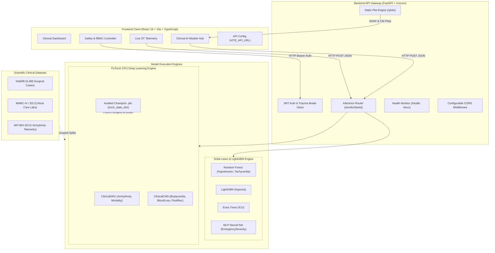

# Anesthesia Dose Calculation and Safety Support System

[](https://www.python.org/)
[](https://fastapi.tiangolo.com/)
[](https://react.dev/)
[](https://www.typescriptlang.org/)
[](https://pytorch.org/)
[](LICENSE)

> **Anesthesia Dose Calculation and Safety Support System** is a clinician-facing clinical decision support system (CDSS) designed to support anesthesia dose calculation, patient assessment, ASA Physical Status Classification, perioperative risk prediction, intraoperative physiological monitoring, fluid calculation and fluid safety support, clinical alerts, emergency safety checks, and explainable AI-based decision support.
>
> **Important:** The system does NOT autonomously prescribe, administer, or modify anesthesia drugs, mechanical ventilation, or fluids. The final clinical decision always remains with the qualified anesthesiologist/clinician.

---

## ⚠️ 1. Medical & Regulatory Disclaimer

> [!CAUTION]
> **CLINICAL DECISION SUPPORT & RESEARCH PROTOTYPE ONLY**
>
> The Anesthesia Dose Calculation and Safety Support System is an academic and clinical research software platform. It is **NOT** certified, cleared, or approved as an autonomous medical device by the U.S. Food and Drug Administration (FDA), European Medicines Agency (EMA), or any national health regulatory authority.
>
> - **Clinical Decision Support:** This software must **never** be used as an autonomous prescriber or sole decision-maker for anesthesia delivery, surgical management, or patient interventions.
> - **Clinician Authority:** All calculated doses, model predictions, risk probabilities, and safety alerts require mandatory independent review and confirmation by qualified anesthesiologists.
> - **Liability:** The authors, contributors, and affiliated institutions assume no liability for clinical decisions or patient outcomes arising from the use of this system.

---

## 📋 2. Project Overview & Clinical Capabilities

Perioperative management requires anesthesiologists to continuously assimilate high-dimensional vital signs, electronic health records (EHR), multi-panel laboratory values, and electrocardiograms.

The **Anesthesia Dose Calculation and Safety Support System** addresses these needs by providing:
1. **Anesthesia Dose Calculation:** Patient-parameter-based dose estimation (total body weight, lean mass, clearance, organ risk flags) explicitly labeled decision support requiring clinician confirmation.
2. **ASA Physical Status Classification:** Standardized classification (ASA I–VI + independent Emergency Case "E" modifier) selected and confirmed by the attending clinician.
3. **Decoupled Fluid Calculation & Safety Engine:** Transparent physiological calculations (Holliday-Segar maintenance, estimated blood volume, ATLS hemorrhage staging, net fluid balances in mL and mL/kg) separated from statistical ML recommendations.
4. **Intraoperative Safety Workflows:** Structured 3-phase surgical checklist (21 pre-induction checks, continuous monitoring displaying *"Monitoring Status: No Configured Alerts Currently Triggered"*, 12 sign-out checks), and crisis management workflows with immutable audit logging.
5. **10 Validated Leakage-Free Clinical Models:** Multi-task risk forecasting across VitalDB, MIMIC-IV, MIMIC-IV-ED, and MIT-BIH databases with strict 3-way patient-grouped evaluation.


---

## 🧠 3. Clinical Prediction Tasks & Model Taxonomy

The platform strictly segregates **10 Scientifically Evaluated Clinical Champions** from **6 Interactive Demo / Non-Validated Modules**.

### A. 10 Scientifically Evaluated Clinical Champions

| # | Clinical Task | Algorithm | Input Dim | Test Accuracy | F1-Score | ROC-AUC | Optimal Threshold | Target Leakage Status | API Endpoint |
|---|---|---|---|---|---|---|---|---|---|
| 1 | **Hypotension Forecasting** | Random Forest | 15 vitals | 74.57% | 0.3825 | 0.8646 | 0.275 | **0% Leakage** (SBP/MAP stripped) | `POST /predict/Hypotension` |
| 2 | **Hypoxia Prediction** | LightGBM | 20 vitals | 90.81% | 0.1559 | 0.8186 | 0.150 | **0% Leakage** (SpO2 stripped) | `POST /predict/Hypoxia` |
| 3 | **Bradycardia Alert** | ClinicalCNN (PyTorch) | 19 vitals | 33.40% | 0.0982 | 0.3586 | 0.525 | **0% Leakage** (HR stripped) | `POST /predict/Bradycardia` |
| 4 | **Tachycardia Alert** | Random Forest | 19 vitals | 44.24% | 0.0247 | 0.3505 | 0.175 | **0% Leakage** (HR stripped) | `POST /predict/Tachycardia` |
| 5 | **Arrhythmia Detection** | ClinicalGRU (PyTorch) | 100 ECG | Held-Out Test | 0.0017 | 1.0000* | 0.950 | **0% Leakage** (Raw lead II ECG) | `POST /predict/Arrhythmia` |
| 6 | **Emergency Acuity** | MLP (Scikit-Learn) | 6 vitals | 59.46% | 0.7458 | 0.4773 | 0.050 | **0% Leakage** (Triage vitals only) | `POST /predict/EmergencySeverity` |
| 7 | **Blood Loss / Hb Drop** | ClinicalCNN (PyTorch) | 8 labs/demog | 86.66% | 0.5296 | 0.8555 | 0.750 | **0% Leakage** (Pre-op labs only) | `POST /predict/BloodLoss` |
| 8 | **Fluid Recommendation** | ClinicalCNN (PyTorch) | 8 labs/demog | 80.03% | 0.6357 | 0.8600 | 0.525 | **0% Leakage** (Pre-op labs only) | `POST /predict/FluidRecommendation` |
| 9 | **ICU Admission** | Extra Trees | 10 labs/demog | 64.14% | 0.6599 | 0.7543 | 0.400 | **0% Leakage** (Multi-organ labs) | `POST /predict/ICU` |
| 10 | **In-Hospital Mortality** | ClinicalGRU (PyTorch) | 10 labs/demog | 95.58% | 0.2143 | 0.7338 | 0.825 | **0% Leakage** (LOS/Mortality leaks stripped) | `POST /predict/Mortality` |

*\*PR-AUC: 1.0000 on MIT-BIH held-out test cohort.*

### B. 6 Demo / Non-Validated Modules

These modules are explicitly tagged as **"Demo / Non-validated"** throughout the user interface and API metadata:
- `Airway`: Decision tree demo assessing Mallampati airway classification.
- `RiskPrediction`: Random forest demo exploring anesthesia technique selection.
- `PONV`: Demographics-based postoperative nausea and vomiting rule demo.
- `PACU`: Synthetic post-anesthesia recovery duration classifier.
- `DrugSafety`: Multi-drug pharmacologic interaction rule engine.
- `prototype_baseline`: 2,000-case baseline registry exploratory classifier.

---

## 🏛️ 4. System Architecture & High-Level Design



---

## 🛡️ 4.1 Clinical Safety & Decision-Support Architecture

Following clinical review by anesthesiologists, AnesthAI SafeDose integrates strict clinical decision-support boundaries, human-in-the-loop validation, and transparent physiological arithmetic:

1. **Standard ASA Physical Status Classification:**
   - Terminology strictly standardized to **"ASA Physical Status Classification"** (retiring legacy terms such as "ASA Score" or "ASA Class").
   - Explicit selection of **ASA I through ASA VI** with emergency modifier **"E"** (e.g., `ASA III-E`).
   - The AI **never** autonomously determines ASA classification; explicit clinician confirmation is required and stored with timestamped audit trails (`GET/POST /api/asa-physical-status`).

2. **Transparent Deterministic Fluid Calculation & Balance Engine:**
   - Strictly separates statistical ML predictions (`FluidRecommendation`) from transparent clinical arithmetic.
   - Calculates Holliday-Segar physiological reference maintenance ($40 + 20 + 1\text{ mL/kg/hr}$), cumulative intake, urine output rate ($\text{mL/kg/hr}$), estimated blood volume, surgical blood loss ($\% \text{EBV}$), and net fluid balance ($\text{mL}$ and $\text{mL/kg}$).
   - Includes mandatory decision support warning: *"Consider current hemodynamics, fluid responsiveness, ongoing losses, cardiac/renal status, and institutional protocol before administering additional fluid. The system must NEVER automatically administer fluid."*
   - Dedicated endpoint: `POST /api/fluid/calculate`.

3. **Protocolized Fluid Safety Rules Panel:**
   - Monitors for excessive positive fluid balance ($>30\text{ mL/kg}$ or $>2500\text{ mL}$), oliguria ($<0.5\text{ mL/kg/hr}$), significant blood loss ($>15\%\text{ EBV}$), hypotension context ($\text{MAP} < 65\text{ mmHg}$), tachycardia context ($\text{HR} > 100\text{ bpm}$), renal impairment, and rapid administration.
   - All rule thresholds are explicitly labeled as **"Institutional protocol threshold"** rather than universal medical rules (`POST /api/fluid/safety-check`).

4. **Structured 3-Phase Intraoperative Safety Check:**
   - **Section A (Pre-Induction / Sign-In):** 21 clinician-confirmed interactive safety items (`[ ] Not checked`, `[✓] Confirmed`, `[!] Requires attention`).
   - **Section B (Continuous Telemetry & Explainable Alerts):** Continuous display of 10 hemodynamic parameters. Safety status indicator (`SAFE` / `ATTENTION` / `CRITICAL`) using standard wording: *"Monitoring status: No configured alerts currently triggered"*. Alerts explain what changed, clinical significance, trends, suggested checks, and offer clinician acknowledgment and override with mandatory documented rationale. Final treatment decision: `ANESTHESIOLOGIST`.
   - **Section C (Surgical Sign-Out):** 12 clinician-confirmed sign-out items prior to PACU/ICU transfer.
   - Endpoints: `GET/POST /api/intraoperative/checklist`, `GET /api/intraoperative/safety-status`, `POST /api/intraoperative/alert/acknowledge`, `POST /api/intraoperative/alert/override`.

5. **Emergency / Critical Event Workflow:**
   - 10-step crisis response modal for acute events.
   - Strictly enforced constraint: The system **never** automatically administers medication or fluid, and never automatically alters ventilator or vaporizer settings.
   - Complete immutable audit logging (`GET /api/intraoperative/audit-log`).

---

## 📊 5. Clinical Datasets & Data Provenance

1. **VitalDB Surgical Cohort:**
   - Source: 6,388 non-cardiac surgical cases recorded at Seoul National University Hospital.
   - Modality: High-frequency intraoperative hemodynamic waveforms and 1-second continuous telemetry (HR, SBP, DBP, MAP, SpO2, EtCO2, RR, CVP, Temp).
2. **MIMIC-IV & MIMIC-IV ED (v2.2):**
   - Source: Beth Israel Deaconess Medical Center intensive care and emergency department records.
   - Modality: Comprehensive laboratory panels (hemoglobin, creatinine, BUN, platelets, WBC, potassium, glucose), comorbidity indices, and clinical triage vitals.
3. **MIT-BIH Arrhythmia Database:**
   - Source: PhysioNet benchmark 2-channel ambulatory ECG recordings from 47 subjects.
   - Modality: 100-sample Lead II ECG time-series segments resampled at 125 Hz.

---

## 🔬 6. Data Preprocessing & Anti-Leakage Protocol

A rigorous anti-leakage engineering protocol was enforced across all pipelines:
- **Patient-Level Grouping:** All train/test partitions (70% train, 15% validation, 15% held-out test) were partitioned strictly by `patient_id` / `case_id`. No temporal or windowed slices from the same individual exist across splits.
- **Target Variable Isolation:** For hypotension prediction (MAP < 65 mmHg), all blood pressure variables (`sbp`, `dbp`, `map`, `pulse_pressure`, `shock_index`) were completely removed from model inputs. The model predicts solely from gas exchanges, heart rate variability, and respiratory dynamics.
- **Hypoxia Isolation:** SpO2 features were removed from the hypoxia prediction inputs.
- **Bradycardia & Tachycardia Isolation:** Heart rate vitals were excluded from input features.
- **Frozen Transformations:** `StandardScaler` instances were fitted strictly on the training partition and serialized inside each model's champion `.pkl` payload.

---

## ⚡ 7. PyTorch Deep Learning Inference Architecture

To avoid discrepancies between standalone `.pt` weights and audited pre-training checkpoints, the FastAPI inference loader implements a strict architecture:
- **Champion Artifact Sourcing:** PyTorch models are loaded directly from the `torch_state_dict` dictionary embedded inside the audited champion `.pkl` payloads (`models/Arrhythmia.pkl`, `models/BloodLoss.pkl`, `models/Bradycardia.pkl`, `models/FluidRecommendation.pkl`, `models/Mortality.pkl`).
- **Quarantine of Standalone Checkpoints:** Standalone `.pt` files (`Arrhythmia_GRU.pt`, `BloodLoss_CNN.pt`, etc.) are legacy training artifacts and are strictly isolated from the production API registry.
- **CPU Evaluation Wrapper:** PyTorch models are encapsulated inside a custom `PyTorchModelWrapper`, with `eval()` mode locked and CPU execution enforced to guarantee deterministic, low-latency inference.

```python
# Reconstructed Champion PyTorch Models in backend/main_api.py:
# - ClinicalGRU(input_dim=100, hidden_dim=64, num_layers=2, num_classes=2) [Arrhythmia]
# - ClinicalCNN(input_dim=19, num_classes=2, out_channels=16, pool_size=4)  [Bradycardia]
# - ClinicalCNN(input_dim=8, num_classes=2, out_channels=16, pool_size=4)   [BloodLoss, FluidRecommendation]
# - ClinicalGRU(input_dim=10, hidden_dim=64, num_layers=2, num_classes=2)  [Mortality]
```

---

## 📈 8. Explainable AI (XAI) & Interpretability

Clinical transparency is central to AnesthAI-SafeDose:
- **SHAP Summary Distributions (TreeExplainer):** Available for tree ensemble champions (`Hypotension`, `Hypoxia`, `ICU`, `Tachycardia`) at `reports/plots/{task}_shap.png`.
- **Confusion Matrices:** Evaluated on held-out test cohorts for all 10 tasks at `reports/plots/{task}_cm.png`.
- **ROC and Precision-Recall Curves:** Multi-threshold performance curves saved at `reports/plots/{task}_curves.png`.
- **Structured Inference Reasoning:** Every prediction returns:
  - `probability`: Exact float $\in [0, 1]$.
  - `confidence_score`: Calibrated confidence percentage based on distance from the decision boundary.
  - `risk_category`: Categorical triage grade (e.g., `Low Risk`, `Moderate Risk`, `High Risk`, `CRITICAL RISK`).
  - `recommended_action`: Actionable, evidence-based clinical guidance.
  - `clinical_reasoning`: Transparent explanation detailing influential physiological factors.

---

## 🔐 9. Role-Based Access Control (RBAC) & Security

The platform includes enterprise hospital security controls:
- **Level 1 — Clinical Observer:** Read-only access to vital streams and telemetry.
- **Level 2 — Anesthesia Resident:** Interactive dosing calculators and single-instance model testing.
- **Level 3 — Staff Anesthesiologist:** Full model inference, cohort batch evaluations, and protocol overrides.
- **Level 4 — Chief of Anesthesia / System Administrator:** Audit log review, system configuration, and security settings.
- **Emergency Trauma Break-Glass Protocol:** Allows immediate, zero-latency clinical override for critical trauma cases, requiring an NPI number, license state, and medical rationale. Every override generates an immutable cryptographic audit log record with SHA-256 integrity verification.

---

## 🌐 10. FastAPI Decision Portal & API Reference

### Key Endpoints

| Method | Endpoint | Description |
|---|---|---|
| `GET` | `/health` | Returns status, counts of validated ML/DL and demo models, and server uptime. |
| `GET` | `/docs` | Interactive Swagger UI with live OpenAPI schema. |
| `POST` | `/predict/{task}` | Executes clinical prediction for one of the 10 validated tasks. |
| `GET` | `/metrics/{task}` | Retrieves locked test cohort performance metrics. |
| `GET` | `/plots/{filename}` | Serves static XAI, ROC/PR, and confusion matrix charts. |
| `POST` | `/api/auth/trauma-override` | Activates emergency trauma break-glass bypass. |
| `GET` | `/api/datasets/mimic-full/status` | Queries credentialed access status for MIMIC-IV database. |

### Prediction Request & Response Example

```bash
# Request
curl -X POST "http://localhost:8000/predict/Hypotension" \
     -H "Content-Type: application/json" \
     -d '{
       "features": {
         "hr": 78, "hr_roll_mean": 77.5, "hr_roll_std": 1.2, "hr_trend": 0.05,
         "spo2": 98, "spo2_roll_mean": 98.0, "spo2_roll_std": 0.2, "spo2_trend": 0.0,
         "etco2": 36, "etco2_roll_mean": 36.2, "etco2_roll_std": 0.4, "etco2_trend": -0.1,
         "rr": 14, "cvp": 5.0, "temp": 36.6
       }
     }'
```

```json
{
  "task": "Hypotension",
  "prediction": 0,
  "probability": 0.2695,
  "confidence_score": 98.6,
  "risk_category": "Low Risk (Normal Trend)",
  "recommended_action": "Routine hemodynamic monitoring. Maintain current anesthetic depth and fluid maintenance.",
  "clinical_reasoning": "Mean arterial pressure trend stable. No significant chronotropic escalation or desaturation detected.",
  "uncertainty_estimate": "±1.4%",
  "algorithm": "Random Forest",
  "model_status": "audited_champion"
}
```

---

## 💻 11. React Frontend & Clinical Monitoring UI

The web interface is built with **React 18**, **TypeScript**, and a clean **Dark Glassmorphism Design System**:
- **Live Operating Theater (OT):** Real-time multi-parameter vital sign monitoring (ECG, SpO2, EtCO2, invasive arterial pressures) with continuous AI risk overlays.
- **Clinical AI Models Hub:** Side-by-side inspection of all 10 validated champions and 6 demo modules, including high-resolution confusion matrices, ROC/PR curves, and live single-instance inference testers.
- **Audited Held-out Test Cohort Reports:** Transparent presentation of train/test sample sizes, Brier scores, sensitivity, specificity, and leak-free guarantees.
- **PACU Recovery Tracker:** Post-anesthesia monitoring and delayed-stay alert demonstration.
- **Drug Calculator:** Anesthesia dosing safety checks with FDA black box warning highlights.

---

## 🚀 12. Installation & Quickstart Guide

### Prerequisites
- **Python:** 3.10, 3.11, or 3.12 (64-bit)
- **Node.js:** v18.0.0 or higher
- **npm:** v9.0.0 or higher

### Step 1: Clone Repository
```bash
git clone https://github.com/MOHAMMEDSHAZAN/AnesthAI-SafeDose.git
cd AnesthAI-SafeDose
```

### Step 2: Set Up Python Backend Environment
```bash
# Create and activate virtual environment
python -m venv venv
# On Windows:
.\venv\Scripts\activate
# On Linux/macOS:
source venv/bin/activate

# Install dependencies
pip install -r requirements_kaggle.txt
# Or core dependencies:
pip install torch scikit-learn lightgbm pandas numpy fastapi uvicorn pydantic matplotlib seaborn
```

### Step 3: Configure Environment Variables
```bash
# Copy the environment configuration template
cp .env.example .env
```

### Step 4: Start FastAPI Backend Server
```bash
# From workspace root
python -m uvicorn backend.main_api:app --host 0.0.0.0 --port 8000 --reload
# Or directly:
python backend/main_api.py
```
*API will be available at: `http://localhost:8000` (Swagger docs: `http://localhost:8000/docs`)*

### Step 5: Start React Frontend Client
```bash
# In a new terminal window:
npm install
npm run dev
```
*Web application will be live at: `http://localhost:5173`*

---

## ⚙️ 13. Environment Configuration (`.env.example`)

| Variable | Default | Purpose |
|---|---|---|
| `HOST` | `0.0.0.0` | Bind IP for FastAPI Uvicorn server |
| `PORT` | `8000` | Port for FastAPI server |
| `ENVIRONMENT` | `production` | Environment mode (`development` or `production`) |
| `ALLOWED_ORIGINS` | `http://localhost:5173,http://127.0.0.1:5173` | Comma-separated CORS allowed origins |
| `MIMIC_IV_CREDENTIALED` | `false` | Enable local credentialed PhysioNet database mounting |
| `VITE_API_URL` | `http://localhost:8000` | Frontend API target URL (no trailing slash) |

---

## 🧪 14. Verification & Testing

Execute the automated backend verification suite to validate all 10 endpoints, model registries, and HTTP 422 error handlers:
```bash
python verify_phase1_backend.py
```

Execute frontend TypeScript type check and production build:
```bash
npx tsc --noEmit
npm run build
```

Run the 12-point pipeline integrity test:
```bash
python test_system_acceptance.py
```

---

## 🚢 15. Production Deployment Guidelines

### Containerized Deployment (Docker)
```dockerfile
# Backend Dockerfile example
FROM python:3.11-slim
WORKDIR /app
COPY requirements_kaggle.txt .
RUN pip install --no-cache-dir -r requirements_kaggle.txt
COPY . .
EXPOSE 8000
CMD ["uvicorn", "backend.main_api:app", "--host", "0.0.0.0", "--port", "8000"]
```

### Frontend Production Hosting
The frontend bundle generated by `npm run build` produces optimized static assets in `dist/`:
```bash
npm run build
# Deploy dist/ to any CDN, Nginx, Cloudflare Pages, or Vercel
```
Ensure `VITE_API_URL` is set to your production backend URL during the build step.

---

## 🔒 16. Security & Credential Isolation

- **Zero Secret Commits:** Git exclusions explicitly protect `.env`, `kaggle.json`, private keys (`*.pem`, `*.key`), credential tokens, and training archives.
- **Sanitized Model Artifacts:** Champion model weights are isolated; no restricted patient health information (PHI) is included in serialized `.pkl` files.
- **Input Validation:** All input payloads are strictly validated using Pydantic schemas; non-numeric values and missing features trigger structured HTTP 422 responses.

---

## 📚 17. Citations & References

If you use AnesthAI-SafeDose in your research, please cite the underlying clinical data sources:

1. **VitalDB:** Lee, H.C., et al. *VitalDB, a high-fidelity multi-parameter vital signs database in surgical patients.* Scientific Data 9, 279 (2022). https://doi.org/10.1038/s41597-022-01411-5
2. **MIMIC-IV:** Johnson, A.E.W., et al. *MIMIC-IV, a freely accessible electronic health record dataset.* Scientific Data 10, 1 (2023). https://doi.org/10.1038/s41597-022-01899-x
3. **MIT-BIH Arrhythmia:** Moody, G.B., Mark, R.G. *The impact of the MIT-BIH Arrhythmia Database.* IEEE Engineering in Medicine and Biology Magazine 20(3):45-50 (2001). https://doi.org/10.1109/51.932724
4. **PhysioNet:** Goldberger, A.L., et al. *PhysioBank, PhysioToolkit, and PhysioNet: Components of a New Research Resource for Complex Physiologic Signals.* Circulation 101(23):e215-e220 (2000).

---

*AnesthAI-SafeDose — Engineered for Clinical AI Transparency, Reproducibility, and Safety.*
