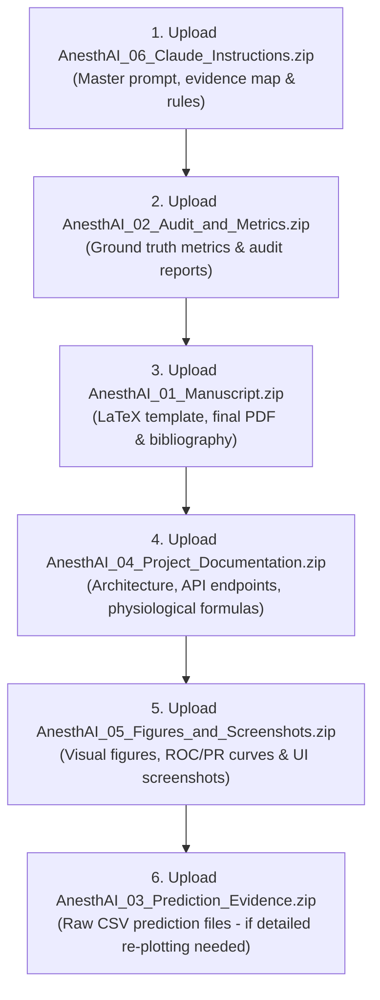

# Claude Upload Order & Interaction Guide

This guide explains the optimal sequence for uploading the split ZIP packages to Claude so you never hit context or file size limits, and Claude gets the exact evidence in the logical order it needs.

---

## Recommended Upload Workflow

---

## Step-by-Step Instructions

### Step 1: Upload `AnesthAI_06_Claude_Instructions.zip` (0.02 MB)
* **Why First:** This package contains `START_HERE.md`, `PROJECT_EVIDENCE_GUIDE.md`, and `FINAL_CLAUDE_PAPER_PROMPT.md`.
* **Prompt to Give Claude:**
  > *"I am providing the instructions and evidence guide for writing my IEEE research paper: 'AnesthAI SafeDose: Anesthesia Dose Calculation and Safety Support System'. Please unpack this archive, inspect `START_HERE.md` and `FINAL_CLAUDE_PAPER_PROMPT.md`, and confirm you understand the ground-truth rules and strict 6.0-page IEEE format."*

### Step 2: Upload `AnesthAI_02_Audit_and_Metrics.zip` (0.03 MB)
* **Why Second:** This package contains `FINAL_RELEASE_AUDIT.md`, `Metrics_Verification.md`, and `reviewer_report.md`.
* **Prompt to Give Claude:**
  > *"Here is the authoritative release audit and metric verification package. `FINAL_RELEASE_AUDIT.md` is your primary source of truth. Note the exact 4 CSV prediction tasks (Arrhythmia AUC 0.9414, Hypotension AUC 0.6927 at threshold 0.500, Hypoxia AUC 0.9047, Tachycardia AUC 0.6980) and the 6 locked audit-baseline tasks. Confirm receipt of the ground truth."*

### Step 3: Upload `AnesthAI_01_Manuscript.zip` (6.55 MB)
* **Why Third:** This package contains the existing 6.0-page PDF (`AnesthAI_IEEE_Final.pdf`), LaTeX source (`main_final.tex`), `IEEEtran.cls`, and `references.bib`.
* **Prompt to Give Claude:**
  > *"Here is the current manuscript source code and compiled PDF. Inspect `main_final.tex` to understand how the sections, tables (Tables I–VI), and figures (Figs. 1–7) are structured in two-column IEEE format."*

### Step 4: Upload `AnesthAI_04_Project_Documentation.zip` (0.02 MB)
* **Why Fourth:** Provides background on deterministic formulas (Holliday-Segar, Nadler EBV, ATLS, Janmahasatian), API endpoints, and system architecture.
* **Prompt to Give Claude:**
  > *"Here is the system architecture, clinical calculations, and software test documentation to support the methodology and clinical justification in Sections III and IV."*

### Step 5: Upload `AnesthAI_05_Figures_and_Screenshots.zip` (11.17 MB)
* **Why Fifth:** Contains high-resolution publication figures (Figs. 1–7), ROC/PR curves, confusion matrices, and 12 authentic application screenshots.
* **Prompt to Give Claude:**
  > *"Here are the high-resolution figures, confusion matrices, and application screenshots referenced in the paper. Refer to `figure_inventory.md` for exact captions and dimensions."*

### Step 6 (Optional / As Needed): Upload `AnesthAI_03_Prediction_Evidence.zip` (9.80 MB)
* **Why Last:** This package contains the four raw CSV prediction files ($2,143,291$ total samples) and evaluation scripts.
* **When Needed:** Claude already has all exact verified metrics in `Metrics_Verification.md` (from Step 2). Only upload this package if you want Claude to perform fresh data analysis or re-plot graphs directly from raw CSV data.

---

## Size Verification Guarantee
Every package in this folder is strictly **below 15 MB**:
- `AnesthAI_06_Claude_Instructions.zip`: 0.02 MB
- `AnesthAI_02_Audit_and_Metrics.zip`: 0.03 MB
- `AnesthAI_04_Project_Documentation.zip`: 0.02 MB
- `AnesthAI_01_Manuscript.zip`: 6.55 MB
- `AnesthAI_03_Prediction_Evidence.zip`: 9.80 MB
- `AnesthAI_05_Figures_and_Screenshots.zip`: 11.17 MB

No upload will fail Claude's file size threshold!
